<picture>
  <source media="(prefers-color-scheme: dark)" srcset="assets/banner-dark.svg">
  
</picture>

 

I work where models meet the real world: agents that use tools, retrieval over messy data, voice, and assistants that run on small hardware. Most of what I build starts as a problem I hit myself.

[LinkedIn](https://www.linkedin.com/in/sahnijatin/) &nbsp;·&nbsp; [X](https://x.com/sahnijatin_) &nbsp;·&nbsp; [Email](mailto:sahnijatinn@gmail.com)

 

## Building

<picture><source media="(prefers-color-scheme: dark)" srcset="assets/card-livemap-dark.svg"></picture>
<picture><source media="(prefers-color-scheme: dark)" srcset="assets/card-collar-eye-dark.svg"></picture>

<a href="https://github.com/Sahnijatin/esp-box-assistant"><picture><source media="(prefers-color-scheme: dark)" srcset="assets/card-esp-box-assistant-dark.svg"></picture></a>
<picture><source media="(prefers-color-scheme: dark)" srcset="assets/card-outsidermap-dark.svg"></picture>

Projects marked <i>in development</i> are private until they are ready to use. Happy to walk through any of them.

 

## Focus

- **Agent tooling.** MCP servers, tool-use, and making what agents do visible and debuggable.
- **Retrieval.** RAG pipelines and vector search over real-world documents.
- **Local models.** On-prem LLM deployment and LoRA / QLoRA fine-tuning.
- **Voice and edge.** Speech in, speech out, on hardware that fits in a pocket.

 

<picture>
  <source media="(prefers-color-scheme: dark)" srcset="assets/activity-dark.svg">
  
</picture>

Every graphic on this page is generated from code in this repo. Activity refreshes daily via GitHub Actions.

